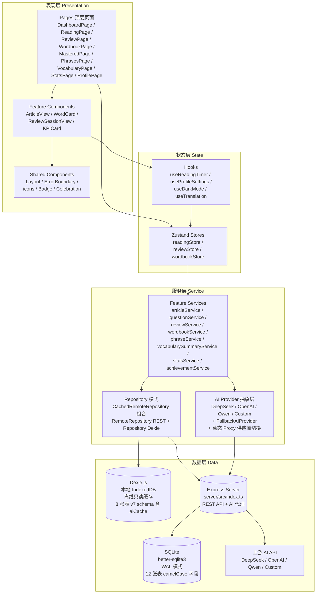
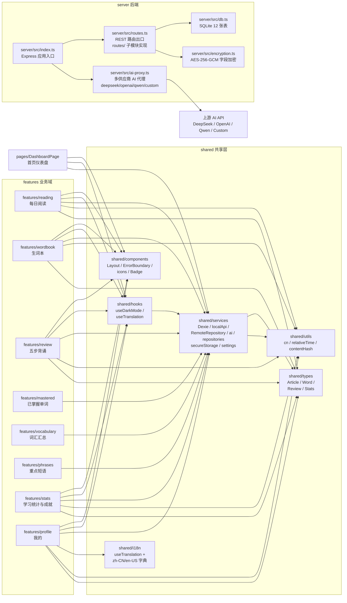
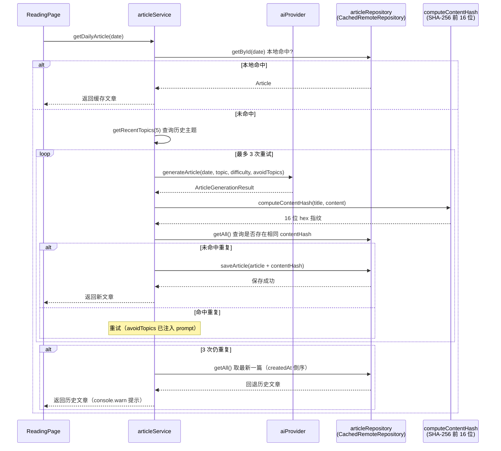
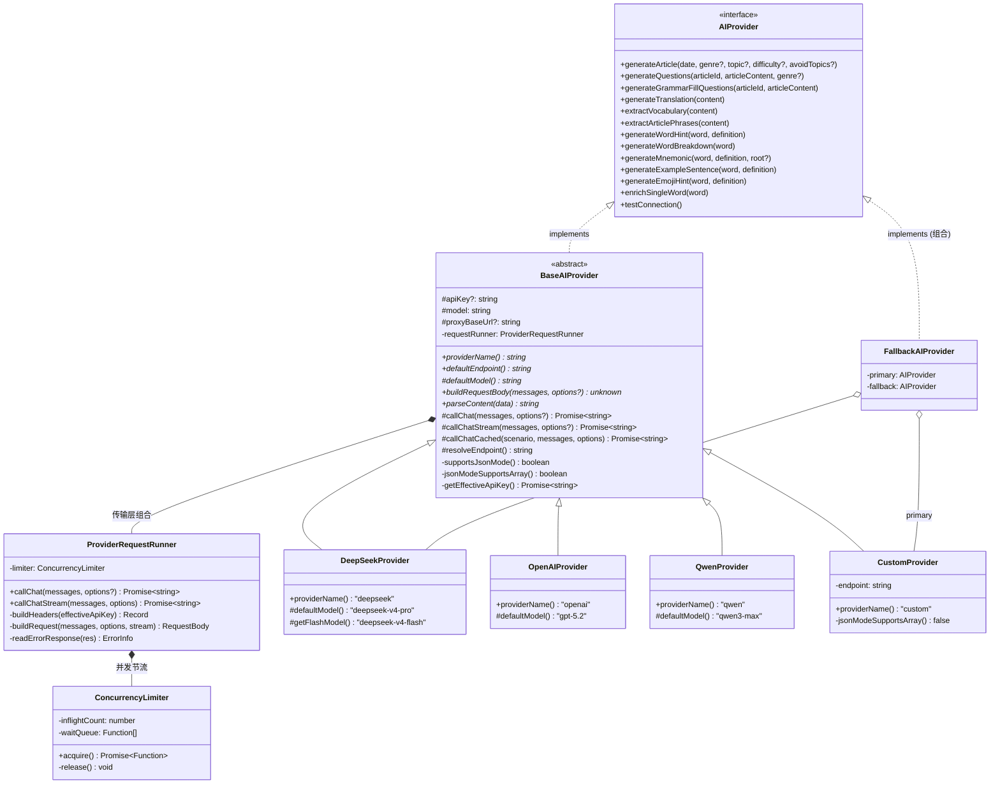

# 架构文档

本文档描述 `ydxl` 英语学习 PWA 应用的整体架构，包括分层结构、模块依赖、数据流、AI Provider 抽象层设计与 PWA 缓存策略。

技术栈：前端 React 18 + Vite 6 + TypeScript 5 + TailwindCSS 3 + Zustand + Dexie.js（离线缓存）+ PWA + 自研 i18n + vitest；后端 Express 4 + better-sqlite3（本地 SQLite）。AI 层支持 DeepSeek / OpenAI / 通义千问 / 自定义模型四类供应商（统一 OpenAI 兼容协议），自定义模型优先调用、失败自动降级 DeepSeek 兜底（`FallbackAIProvider`）。部署方式为 Linux 服务器本地部署（systemd/PM2 + Nginx 反向代理），启用多用户认证（P0 已实施）、无云端依赖。

## 1. 分层架构

应用采用**前后端分离 + 服务器为主 + 离线缓存**的分层架构：表现层 → 状态层 → 服务层 → 数据层。每一层只能调用其下层，禁止反向依赖（数据层不感知服务层、服务层不感知 UI）。



### 各层职责

| 层级 | 职责 | 关键文件 |
| --- | --- | --- |
| 表现层 | 渲染 UI、捕获用户交互、触发状态变更 | `src/pages/`、`src/features/*/components/`、`src/shared/components/` |
| 状态层 | 应用状态管理、副作用编排、跨组件通信 | `src/features/*/store.ts`、`src/shared/hooks/` |
| 服务层 | 业务逻辑、AI 调用、Repository 组合 | `src/features/*/services/`、`src/shared/services/` |
| 数据层 | 持久化（服务器 SQLite 主存储 + Dexie 离线缓存）、Express REST 转发 | `src/shared/services/db.ts`、`src/shared/services/localApi.ts`、`server/src/` |

## 2. 模块依赖图

特性模块按业务域垂直拆分，对外通过 `index.ts` 桶文件导出公共 API。**模块间不互相直接引用内部文件**，所有跨特性复用通过 `shared/` 共享层。



### 模块边界约定

- `features/*` 自包含 `components / pages / services / hooks / types / store`，对外仅通过 `index.ts` 导出公共 API
- `features/reading/services/articleService` 承载文章生成的 contentHash 去重逻辑（调用 `@/shared/utils/contentHash` 计算 SHA-256 指纹）与历史主题注入（查询最近 5 篇文章 topic 后传入 AI prompt），通过 `@/shared/services` 的 `articleRepository`（CachedRemoteRepository）读写数据
- `features/reading/data/fallback-articles` 为兜底素材库：AI 生成失败时自动降级选用（自带完整 highlightedWords/phrases，按 contentHash 与本地文章去重）
- `features/reading/components/PrintableWorksheet` 为一键打印工作表：Portal 挂载到 body（`.print-portal` 容器，`@media print` 隐藏 `#root` 仅显示工作表），渲染原文/题目/答案/单词/短语/翻译七大板块；`ReadingPage` 的 `usePrintWorksheet` 在题目未生成（懒生成）时先并行补齐阅读理解与语法填空再唤起 `window.print()`，生成失败降级打印文章内容
- `features/reading/pages/ReadingPage` 仅负责视图编排：文章加载与短语补全在 `hooks/useArticleLoader`，答题/语法填空/练习生成与重试在 `hooks/useQuizRunner`，打印在 `hooks/usePrintWorksheet`
- `shared/services` 暴露 Dexie 仓储（离线缓存）、localApi（REST 客户端）、RemoteRepository / CachedRemoteRepository、AI Provider 抽象（四供应商 + 兜底 + 动态 Proxy）、secureStorage（用户密钥/敏感数据加密存储）
- `shared/components`、`shared/hooks` 与具体业务无关，可被任意特性模块复用
- `shared/i18n` 提供轻量 `useTranslation` hook，基于 localStorage 语言选择 + JSON 字典查找，支持参数插值与跨标签页同步
- `server/` 为独立子包，包含 Express 应用入口、REST 路由工厂、SQLite 数据库初始化、AI 代理端点（四供应商）与多用户认证
- `config/ai-providers.json` 声明 custom 的端点 / 模型与兜底供应商；内置供应商（deepseek/openai/qwen）的服务端转发元数据（端点 / 白名单 / 密钥变量名 `keyEnv`，只存变量名不存密钥值）由 `server/src/aiConfig.ts` 的 `DEFAULT_PROVIDERS` 提供，JSON 的 `providers` 段可选覆盖；前端构建注入 `VITE_CUSTOM_*` / `VITE_FALLBACK_*`，服务端启动派生 `CUSTOM_API_ENDPOINT` / `CUSTOM_MODELS`，`ai-proxy.ts` 的 UPSTREAMS 注册表亦从它派生（加载器 `server/src/aiConfig.ts`）

## 3. 数据流：前端 → REST API → Express → SQLite

应用采用**服务器为主**策略：所有读写优先请求 Express REST API（持久化到服务器 SQLite），失败时回退 Dexie 本地缓存。写入成功后同步更新本地缓存，保证离线时仍可读取最近数据。

```mermaid
sequenceDiagram
    participant UI as UI / Feature Service
    participant Cached as CachedRemoteRepository
    participant Remote as RemoteRepository (REST)
    participant Local as Repository (Dexie)
    participant Express as Express Server
    participant SQLite as SQLite (WAL)

    Note over UI,Cached: 用户操作触发数据访问
    UI->>Cached: 读取 / 写入数据

    alt 读取（getAll / getById）
        Cached->>Remote: GET /api/{table} 或 GET /api/{table}/:id
        alt 服务器可达
            Remote->>Express: HTTP 请求
            Express->>SQLite: SELECT（WAL 并发读）
            SQLite-->>Express: 行数据（camelCase）
            Express-->>Remote: JSON 响应（JSON 字段已反序列化）
            Remote-->>Cached: records
            Cached->>Local: bulkPut(records) 同步缓存
            Cached-->>UI: records
        else 服务器不可达
            Remote-->>Cached: 抛错（网络异常）
            Cached->>Local: getAll() / getById() 回退缓存
            Local-->>Cached: 缓存数据
            Cached-->>UI: 缓存数据（离线只读）
            Note over UI: dispatch CustomEvent('ydxl:offline')<br/>提示「网络不可用，仅可查看已缓存数据」
        end
    end

    alt 写入（create / update / delete）
        Cached->>Remote: POST / PUT / DELETE /api/{table}
        Remote->>Express: HTTP 请求
        Express->>SQLite: INSERT / UPDATE / DELETE<br/>自动填充 updated_at
        SQLite-->>Express: 成功
        Express-->>Remote: 201 / 200 / 204
        alt 写入成功
            Cached->>Local: 同步写入本地缓存
            Cached-->>UI: 写入结果
        end
    end
end
```

### 关键设计点

- **服务器为主**：所有读写优先请求 Express REST API（`/api/{table}`），服务器 SQLite 为唯一权威数据源。
- **离线回退**：服务器不可达时，读取回退 Dexie 本地缓存（离线只读模式），写入直接抛错并提示用户。
- **离线通知**：`localApi.ts` 检测到 fetch 失败时，通过 `window.dispatchEvent(new CustomEvent('ydxl:offline'))` 通知 UI 显示离线提示 toast。
- **字段命名一致**：服务器 SQLite 与前端 Dexie 均使用 camelCase 字段名（`wordCount`、`createdAt`、`lexileRange` 等），无需字段映射转换。仅 `updated_at` 保留 snake_case 以与前端 `BaseEntity` 类型对齐。
- **JSON 字段序列化**：`server/src/db.ts` 的 `JSON_COLUMNS` 声明 object/array 字段（如 `lexileRange`、`highlightedWords`、`options`、`achievementTags`），写入时 `JSON.stringify`、读取时 `JSON.parse`，对前端透明。
- **WAL 模式**：SQLite 启用 `journal_mode = WAL` 提升并发读性能，支持读写并发。
- **表名白名单**：`server/src/routes/shared.ts` 的 `TABLES` 常量定义 7 张表白名单，防止 SQL 注入（表名不可参数化）。
- **自动时间戳**：POST / PUT 自动填充 `updated_at = Date.now()`（毫秒时间戳）。
- **多用户认证**：除 `/api/health` 与 `/api/auth/*` 外全部业务端点需登录（会话令牌，scrypt 哈希 + 失败锁定 + 限流，P0 已实施）。
- **限流与 CORS**：服务端引入 `express-rate-limit`（每 IP 60/min，超限 429），CORS 通过 `CORS_ORIGIN` 环境变量支持白名单。

### 3.1 阅读存档去重数据流

文章生成时通过 contentHash 指纹去重，避免用户看到重复内容。去重查询走 `CachedRemoteRepository`，服务器不可达时 best-effort 跳过查重（不阻塞生成流程）。



阅读完成时由 `ReadingPage` 调用 `markAsRead` 写入 `readAt` 时间戳，best-effort 标记失败不影响主流程。

### 3.2 CachedRemoteRepository.update 404 兜底策略

`CachedRemoteRepository.update(id, patch)` 在远程 PUT 失败时采用分级兜底策略，避免调用方因远程 404 阻塞业务流程：

```mermaid
sequenceDiagram
    participant UI as UI / Feature Service
    participant Cached as CachedRemoteRepository
    participant Remote as RemoteRepository (REST)
    participant Local as Repository (Dexie)

    UI->>Cached: update(id, patch)
    Cached->>Remote: PUT /api/{table}/{id}
    alt 远程成功
        Remote-->>Cached: 更新后的实体
        Cached->>Local: 同步更新本地缓存（best-effort）
        Cached-->>UI: 返回更新后的实体
    else 远程 404（记录不存在）
        Remote-->>Cached: 抛错（message 含 "404"）
        Cached->>Local: best-effort 写入本地缓存
        Note over Cached: 返回 fallback 对象<br/>{ ...patch, id, updated_at: Date.now() }
        Cached-->>UI: 返回 fallback 对象（不抛错）
    else 远程 500 / 网络错误
        Remote-->>Cached: 抛错
        Cached->>Local: best-effort 写入本地缓存
        Cached-->>UI: 重新抛出原始错误
    end
end
```

**关键设计点**：

- **404 特殊兜底**：当远程 PUT 返回 404（记录在服务器不存在）时，`CachedRemoteRepository` 不向上抛错，而是返回一个 fallback 对象 `{ ...patch, id, updated_at: Date.now() } as T`，让调用方继续执行后续逻辑。适用于「先写后补」场景——某些实体可能尚未同步到服务器，但本地缓存或内存中已存在，调用方期望拿到一个可用的实体引用。
- **best-effort 本地写入**：无论远程成功还是失败，都会尝试将 `patch` 写入本地 Dexie 缓存（失败仅 `console.warn`，不阻塞主流程）。
- **非 404 错误透传**：远程 500 / 网络错误等非 404 异常会重新抛出，由调用方决定如何处理（重试 / 提示用户等）。
- **源码位置**：`src/shared/services/remoteRepository.ts` 的 `CachedRemoteRepository.update` 方法。

### 3.3 生词本 AI 补全机制

生词本模块（`features/wordbook`）在写入生词时支持按需 AI 补全缺失字段，确保生词本中可见音标、词性、释义与例句。核心由 `wordbookService` 的 `enrichWord` 与 `addToWordbook` 的 `enrichIfMissing` 参数协作完成。

#### 3.3.1 isMissingField 占位值检测

`wordbookService.isMissingField`（私有函数）判断字段是否为「缺失」或「占位值」，从而决定是否需要 AI 补全。占位值来源于 `wordLookup.lookupWord` 未命中本地字典时返回的占位数据：

| 输入值 | 判定 | 说明 |
| --- | --- | --- |
| `undefined` / `''` / 纯空白字符串 | ✅ 缺失 | 空值视为缺失 |
| `'/-/'` | ✅ 占位 | 音标占位值（lookupWord 未命中时返回） |
| `'未知'` | ✅ 占位 | 词性占位值（lookupWord 未命中时返回） |
| 包含 `'暂未收录'` 的字符串 | ✅ 占位 | 释义占位值（lookupWord 未命中时返回） |
| 其他非空非占位字符串 | ❌ 已存在 | 字段完整，无需补全 |

> 源码位置：`src/features/wordbook/services/wordbookService.ts` 的 `isMissingField` 函数。

#### 3.3.2 enrichWord AI 补全流程

`enrichWord(wordId)` 负责对单条生词调用 AI 补全缺失 / 占位字段：

1. 读取现有 word 实体；不存在则抛错。
2. 若 `phonetic` / `pos` / `definition` 全部已存在且非占位值，直接返回（无需补全）。
3. 构造简短上下文 `The word "${word}" is commonly used in English.`，调用 `aiProvider.extractVocabulary` 获取词汇数据。
4. 从返回数组中大小写不敏感地匹配 `word` 字段；未匹配则抛错。
5. 仅更新缺失或占位的字段（`phonetic` / `pos` / `definition` / `example`），已有真实值的字段保留不动。
6. 调用 `wordRepository.update` 写回并返回更新后的实体。

> 源码位置：`src/features/wordbook/services/wordbookService.ts` 的 `enrichWord` 函数。

#### 3.3.3 addToWordbook 的 enrichIfMissing 参数

`addToWordbook(params)` 支持可选参数 `enrichIfMissing`（默认 `false`），用于选词加入生词本场景：

- **`enrichIfMissing: false`（默认）**：仅写入基础实体，不触发 AI 补全。适用于批量导入 / 用户手动填写完整的场景。
- **`enrichIfMissing: true`**：写入后自动调用 `enrichWord(id)`，若 `phonetic` / `pos` / `definition` / `example` 任一缺失或为占位值则触发 AI 补全。采用 **best-effort 语义**——AI 补全失败时仅 `console.warn` 不抛错，返回已写入的基础实体，不阻塞加入生词本主流程。

**典型调用场景**：用户在阅读页选词加入生词本时，`lookupWord` 未命中本地字典返回空字段或占位值（`/-/` / `未知` / `暂未收录`），前端通过 `enrichIfMissing: true` 让 `addToWordbook` 内部自动触发 AI 补全音标 / 词义 / 例句。`AddWordModal` 组件还会在 `addToWordbook` 后显式调用 `enrichWord` 作为双保险，并用返回数据回填表单供用户确认。

> 源码位置：`src/features/wordbook/services/wordbookService.ts` 的 `addToWordbook` 函数与 `AddToWordbookParams` 接口。

## 4. 阅读存档去重机制

为避免用户连续看到重复或高度相似的文章，`articleService.generateArticle` 引入基于内容指纹的去重机制。

### 4.1 contentHash 计算

- **工具位置**：`src/shared/utils/contentHash.ts`
- **算法**：基于「标题 + 换行 + 正文」拼接后 `trim().toLowerCase()` 归一化，优先使用 Web Crypto API 的 `crypto.subtle.digest('SHA-256', data)`；`crypto.subtle` 不可用环境（如部分 jsdom 测试环境）回退到同步 DJB2 变体字符串 hash。
- **输出**：16 位 hex 字符串（SHA-256 前 16 位），碰撞概率约 1/16^16（≈7×10^-20），足以满足文章去重需求。
- **存储**：写入 articles 表 `contentHash` 字段（TEXT），SQLite 建立 `idx_articles_content_hash` 索引加速查重；Dexie v4 schema 为 articles 表新增 `contentHash` 与 `readAt` 索引。

### 4.2 去重流程

1. `generateArticle` 先调用 `getRecentTopics(5)` 查询最近 5 篇文章的 topic 列表（按 createdAt 倒序；Phase 3 从 10 精简到 5 以节省 token）。
2. 将 topic 列表作为 `avoidTopics` 参数注入 `articlePrompt`，追加到 user message 末尾（动态部分，保持 system 前缀稳定以最大化 DeepSeek Context Cache 命中）：「请避免以下最近生成过的主题，选择不同的主题或角度进行创作：...」。user message 末尾同时注入随机叙事视角（5 组「叙事视角 + 开头方式 + 结尾方式」预设随机选一），打破文章模板化。
3. 循环最多 3 次：调用 AI 生成 → 计算 contentHash → 查询历史是否已存在相同 contentHash。
4. 未命中则保存文章（含 contentHash 与 `readAt: null`）并返回。
5. 3 次仍重复则回退到最新一篇历史文章（按 `createdAt` 倒序），`console.warn` 记录日志。

### 4.3 best-effort 去重

去重查询与主题注入均采用 best-effort 策略：`CachedRemoteRepository.getAll()` 抛错时（离线或服务器异常），`findByContentHash` 与 `getRecentTopics` 捕获异常返回 `undefined` / `[]`，跳过去重检查与主题注入，不阻塞文章生成主流程。

### 4.4 阅读存档与历史查询

- **`markAsRead(articleId)`**：通过 `articleRepository.update` 写入 `readAt: Date.now()`；标记失败仅 `console.warn` 不影响阅读主流程（离线或服务器异常时跳过）。
- **`getReadHistory(limit=50)`**：查询全部文章后过滤 `readAt != null`，按 `readAt` 倒序截取前 `limit` 条返回。
- **触发时机**：`ReadingPage` 阅读完成时（通过 ref 避免对同一文章重复调用）调用 `markAsRead`。

## 5. AI Provider 抽象层设计

### 5.1 模板方法模式 + 组合式供应商编排

`BaseAIProvider` 抽象基类封装业务方法编排（结果校验/JSON 模式门控/缓存/Token 统计），传输细节（并发节流、退避重试、fetch/SSE、错误映射）下沉至 `requestRunner.ts`，子类仅需实现差异化方法。当前具体实现：

| 类 | 角色 | 说明 |
| --- | --- | --- |
| `DeepSeekProvider` | 内置供应商 | 端点 `https://api.deepseek.com/chat/completions`，模型分级 `deepseek-v4-pro` / `deepseek-v4-flash`（简单任务自动降级轻量模型省成本） |
| `OpenAIProvider` | 内置供应商 | 端点 `https://api.openai.com/v1/chat/completions`，`gpt-5.2` / `gpt-5.2-mini` |
| `QwenProvider` | 内置供应商 | DashScope compatible-mode 端点，`qwen3-max` / `qwen3-turbo` |
| `CustomProvider` | 自定义供应商 | 任意 OpenAI 兼容端点（OpenRouter / SiliconFlow / Ollama 等），端点/模型来自 `config/ai-providers.json` 或用户个人中心配置；按端点推断平台并透传对应思考开关参数 |
| `FallbackAIProvider` | 组合装饰器 | 包装 primary + fallback 两个供应商：primary（自定义）失败自动以相同参数重试 fallback（DeepSeek 兜底）；流式已产出内容后不降级 |

### 5.1.1 供应商选择优先级与动态 Proxy

所有业务代码统一通过 `aiProvider` 单例调用 AI。该单例是一个 **Proxy 动态委托**：每次方法调用时实时解析当前应使用的供应商实例，实现「个人中心切换供应商免刷新即时生效、修改密钥后下一次请求即用新密钥」：

```
getUserSelectedProvider() 优先级链：
  1. localStorage 用户选择（个人中心，运行时热切换）
  2. VITE_AI_PROVIDER 环境变量（构建时默认）
  3. custom 自动检测（VITE_CUSTOM_API_ENDPOINT + VITE_CUSTOM_MODEL 配齐时自动启用）
  4. deepseek（最终兜底）
```

- 选择 `custom` 时工厂构建 `FallbackAIProvider(CustomProvider, 兜底供应商)`；兜底供应商由 `config/ai-providers.json` 的 `fallback` 字段（或 `VITE_FALLBACK_AI_PROVIDER`）声明，仅允许 `deepseek` / `openai` / `qwen`
- 供应商实例按「名称 + custom 配置指纹」缓存，配置变更后自动重建
- 用户密钥通过 `keyResolver` 机制在**请求时点**动态解析（secureStorage 解密），无同步读取时序问题

### 5.2 类结构



### 5.3 12 个业务方法 + 连接测试

`BaseAIProvider` 实现 `AIProvider` 接口的 12 个业务方法与 `testConnection` 连接测试，复用 `prompts.ts` 的 prompt 模板与 `requestRunner.ts` 的 `callChat` / `callChatStream` 传输层，以及 `withAIError` 异常包装：

| 方法 | 用途 | 结果解析 |
| --- | --- | --- |
| `generateArticle` | 生成每日英文文章（含翻译/蓝思值/高亮生词/重点短语） | `parseJsonResponse` + 9 必要字段逐一校验 + `highlightedWords` 非空数组校验，不合格同供应商重试（最多 3 次） |
| `generateQuestions` | 基于文章生成 5 道阅读理解选择题（流式，按文体命题） | `parseJsonArrayResponse` |
| `generateGrammarFillQuestions` | 生成 5 道语法填空选择题（含四层深度解析） | `parseJsonArrayResponse` |
| `generateTranslation` | 全文中文翻译 | 纯文本 |
| `extractVocabulary` | 提取重点词汇（音标/词性/释义/例句/重要度） | `parseJsonArrayResponse` |
| `extractArticlePhrases` | 提取重点短语（释义/例句/例句翻译） | `parseJsonArrayResponse` |
| `generateWordHint` | 单词图像联想 + 记忆口诀 | `parseJsonResponse` |
| `generateWordBreakdown` | 自然拼读分解（phonics + syllables） | `parseJsonResponse` |
| `generateMnemonic` | 趣味助记口诀 | `parseJsonResponse` |
| `generateExampleSentence` | 真题风格例句 | `parseExampleSentence`（纯文本/JSON 容错） |
| `generateEmojiHint` | 1-3 个 emoji 助记字符 | `parseJsonArrayResponse`（allowPrimitives） |
| `enrichSingleWord` | 生词本补全单词完整信息（含相关短语） | `parseJsonResponse` |
| `testConnection` | 个人中心「测试连接」 | — |

**采样策略**：文章为创作型任务，显式传 `temperature: 0.9` 增加用词/句式多样性（配合 prompt 随机叙事视角打破模板化）；其余结构化 JSON 任务保持供应商默认采样（确定性优先），文章任务同时 `thinkingDisabled: true` 省token。

### 5.4 5 个抽象方法（子类必须实现）

| 方法 | 签名 | 说明 |
| --- | --- | --- |
| `providerName()` | `string` | 返回 Provider 标识（`'deepseek'`），用于代理模式请求体 |
| `defaultEndpoint()` | `string` | 直连模式默认上游端点 URL |
| `defaultModel()` | `string` | 默认模型名（config.model 未指定时使用） |
| `buildRequestBody(messages, options?)` | `unknown` | 构造上游请求体（options 含 maxTokens/thinkingDisabled/modelOverride/reasoningEffort/temperature；直连时即最终请求体，代理时作为信封 `body` 字段） |
| `parseContent(data)` | `string` | 从上游响应中提取助手消息内容（空字符串表示无效） |

### 5.5 双模式调用

应用支持两种调用模式，由 `VITE_AI_PROXY_URL` 环境变量决定：

```mermaid
graph LR
    subgraph 直连模式 开发环境
        FE1[前端 Provider 实例]
        FE1 -->|Authorization: Bearer apiKey| Upstream1[上游 AI API<br/>DeepSeek / OpenAI / Qwen / Custom]
    end

    subgraph 代理模式 生产环境
        FE2[前端 Provider 实例]
        FE2 -->|x-user-token: proxyToken<br/>body: { provider, body }| Proxy[Express AI 代理<br/>server/src/ai-proxy.ts]
        Proxy -->|校验服务端 API_KEY 已配置| Check{对应密钥<br/>已配置?}
        Check -->|否| Err503[503 PROXY_NOT_CONFIGURED<br/>custom 场景前端自动回退 DeepSeek 兜底]
        Check -->|是| Forward[使用服务端对应密钥转发]
        Forward -->|Authorization: Bearer serverKey| Upstream2[上游 AI API]
    end
```

| 模式 | 触发条件 | 鉴权头 | 请求体格式 | 端点 |
| --- | --- | --- | --- | --- |
| 直连 | 未配置 `VITE_AI_PROXY_URL` | `Authorization: Bearer <apiKey>` | 原始 `buildRequestBody` 返回值 | `<defaultEndpoint>` |
| 代理 | 配置 `VITE_AI_PROXY_URL` | `x-user-token: <会话令牌>` | 信封 `{ provider, body }` | `${proxyBaseUrl}/v1/ai-proxy/<provider>` |

代理模式路径前缀 `/v1/ai-proxy/` 用于 API 版本化。前端默认 `VITE_AI_PROXY_URL=/api` 时实际请求路径为 `/api/v1/ai-proxy/<provider>`，由 Express 服务端路由接收并转发到对应上游。

服务端 `server/src/ai-proxy.ts` 支持 `deepseek` / `openai` / `qwen` / `custom` 四个上游节点，各自读取对应密钥环境变量（`DEEPSEEK_API_KEY` / `OPENAI_API_KEY` / `QWEN_API_KEY` / `CUSTOM_API_KEY`）。代理端点位于 `/api` 登录认证之后，由会话中间件校验 `x-user-token`；并强校验「对应供应商密钥已配置」：未配置时返回 `503 PROXY_NOT_CONFIGURED`，避免开放代理被滥用；custom 节点额外支持 `CUSTOM_MODELS` 模型白名单（未配置时不限制，由部署者约定）。custom 返回 503 时，前端 `FallbackAIProvider` 自动回退 DeepSeek 兜底。流式变体端点为 `/v1/ai-proxy/<provider>/stream`。

### 5.6 超时与重试策略

| 端 | 超时阈值 | 触发后行为 | 重试策略 |
| --- | --- | --- | --- |
| 前端 `ProviderRequestRunner.callChat` / `callChatStream` | 170 秒 | `AbortController` + `setTimeout`，超时抛 `RetryableAIError` 并触发重试 | `retryWithBackoff` 指数退避 1s / 2s，最多 2 次重试 |
| 后端 `server/src/ai-proxy.ts` | 150 秒（`UPSTREAM_TIMEOUT_MS`） | `AbortController` + `setTimeout`，超时返回 `504 TIMEOUT` | 不重试（避免上游雪崩） |

> 前端 170s 覆盖服务端 150s 上游超时 + 网络/5xx 重试退避 + 思考时间的端到端时延；第三方推理平台长响应（语法填空等）需 75-150s，前端超时必须大于服务端超时，否则前端会先于服务端误报。

可重试错误类型：

- **网络错误**（`fetch` 抛出非 AIError 的 TypeError 等）→ 可重试
- **超时**（`AbortError` 转 `RetryableAIError`）→ 可重试
- **上游 5xx**（HTTP 状态码 >= 500，转 `RetryableAIError`）→ 可重试
- **429 限流** → 按 `Retry-After` 响应头或响应体 `retry_after` 字段动态退避后重试

不可重试错误：

- **4xx 客户端错误**（如 401 / 400）→ 立即抛 `AIError`（429 除外，见上）
- **响应解析错误**（非 JSON 内容）→ 立即抛 `AIError`
- **内容缺失错误**（`parseContent` 返回空字符串）→ 立即抛 `AIError`
- **外部中断**（用户主动取消的 `AbortError`）→ 直接抛出不重试

错误信息提取：非 2xx 响应先尝试 `res.json()` 提取 `{ error: { message } }` 结构化错误信息，失败回退 `res.text()`。

### 5.7 FallbackAIProvider 自动降级链

`FallbackAIProvider` 实现自定义 API 优先、DeepSeek 兜底的调用策略，降级规则：

| 场景 | 行为 |
| --- | --- |
| 自定义 API 正常 | 直接返回，仅一次请求，不触兜底供应商 |
| 自定义 API 失败（网络/HTTP 错误/超时/JSON 不合格） | `console.warn` 记录后自动以**相同参数**切兜底供应商重试 |
| custom 配置不完整（端点/模型缺失） | 哑供应商作为 primary → 直接走兜底 |
| 兜底供应商密钥也未配置 | 抛回**主供应商原始错误**（诊断价值更高），由上层业务降级（兜底素材库/缓存）接管 |
| 两者都失败 | 抛聚合 `AIError`（含两侧错误摘要，`cause` 保留细节） |
| 流式已输出 chunk 后失败 | **不降级**（重放会导致前端内容重复），直接抛错 |

兜底重试时使用兜底供应商自己的模型分级（简单任务 flash / 复杂任务 pro），不透传 custom 模型 ID。

### 5.8 第三方模型 JSON 兼容性

针对「自定义/第三方模型」与 DeepSeek 官方模型的行为差异，抽象层内置三层兼容机制：

1. **JSON Output 门控**：`jsonMode` 启用时附加 `response_format: { type: 'json_object' }`，但数组类结果场景（题目/词汇/短语/emoji）若供应商 `jsonModeSupportsArray() === false`（如 `CustomProvider`）则跳过该字段 —— 第三方端点严格服从「顶层必须是 object」语义，会把数组退化为单对象。
2. **`parseJsonResponse` 三级容错**（`shared/services/ai/jsonParsing.ts`）：直接 `JSON.parse` → 剥 markdown 代码块围栏 → 提取文本中平衡的 JSON 块。
3. **`parseJsonArrayResponse` 对象解包**：数组预期结果若返回 `{"questions": [...]}` 包装对象，提取唯一数组字段自动解包；带元素类型约束（默认须全为对象，emoji 场景 `allowPrimitives` 放宽），防止把裸单题对象的 `options` 字符串数组误当结果数组。

### 5.9 结果缓存与 Token 统计

- **`callChatCached`**：结构化结果（题目/词汇/短语等）按 `scenario + model + messages` 计算 SHA-256 cacheKey，优先查 Dexie `aiCache` 表（永久缓存同文章结果）与内存 inflight 去重，命中时零 token 消耗。
- **Token 统计**：`tokenStats` 按场景/模型记录每次调用的 prompt/completion tokens 与缓存命中，个人中心可查看用量与费用估算。

## 6. PWA 缓存策略

### 6.1 vite-plugin-pwa 配置

应用通过 `vite-plugin-pwa`（基于 Workbox）实现 PWA 能力，配置位于 `vite.config.ts`：

```ts
VitePWA({
  registerType: 'autoUpdate',
  manifest: { /* 应用清单 */ },
  workbox: {
    globPatterns: ['**/*.{js,css,html,ico,png,svg}'],
  },
})
```

### 6.2 PWA 应用清单

| 字段 | 值 |
| --- | --- |
| `name` | 英语学习应用 |
| `short_name` | 英语学习 |
| `theme_color` | `#4f46e5` |
| `background_color` | `#ffffff` |
| `display` | `standalone` |
| `icons` | 三套：`pwa-192.png` (192x192 any)、`pwa-512.png` (512x512 any)、`pwa-maskable-512.png` (512x512 maskable) |

### 6.3 缓存策略

| 缓存类型 | 范围 | 策略 | 说明 |
| --- | --- | --- | --- |
| Precache | 构建产物（js/css/html/ico/png/svg） | Cache First | Workbox 在 Service Worker 安装时预缓存所有匹配 `globPatterns` 的资源 |
| Runtime cache | 无 | 无 | 项目未配置显式 runtime cache，precache 范围外的请求走网络 + 浏览器默认 HTTP 缓存（详见 [TECHNICAL_ANALYSIS.md](./TECHNICAL_ANALYSIS.md) 第 6 节） |

### 6.4 离线可用功能

- **已加载的文章内容**：通过 precache + IndexedDB 双层缓存，断网时仍可查看
- **生词本 / 复习队列**：Dexie 离线缓存可用，服务器不可达时回退本地数据
- **学习统计**：本地 `stats` 表缓存历史数据，断网可查看
- **五步背诵**：除 AI 生成新内容外，已有单词的五步流程完全离线可用

### 6.5 自动更新策略

- `registerType: 'autoUpdate'`：Service Worker 检测到新版本时自动注册并提示用户刷新
- 用户下次启动应用时（关闭所有标签页后重新打开）会激活新 Service Worker
- 应用内「设置 → 关于」可查看版本号
- 强制更新方法：浏览器控制台执行 `caches.keys().then(ks => ks.forEach(k => caches.delete(k)))` 后刷新

### 6.6 构建优化

`vite.config.ts` 通过 `rollupOptions.output.manualChunks` 手动拆分 vendor chunk：

| Chunk | 内容 | 拆分理由 |
| --- | --- | --- |
| `recharts` | Recharts 图表库 | 体积较大且仅 StatsPage 使用，单独拆分避免污染路由 chunk |
| `react` | react / react-dom / react-router-dom | React 运行时核心库独立 chunk 提升缓存命中率 |

## 相关文档

- [ER 关系图](./ER_DIAGRAM.md)：12 张表（7 业务表 + 5 多用户表）的关系与字段定义
- [测试策略](./TESTING.md)：三层测试策略与运行命令
- [README](../README.md)：项目概述与快速开始
