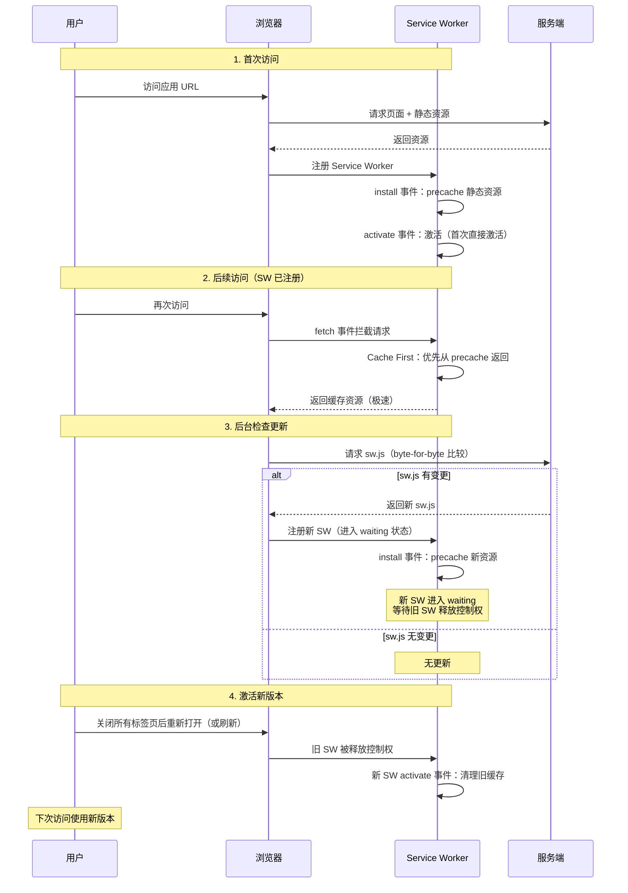

# 技术分析文档

本文档对 `ydxl` 英语学习 PWA 应用的核心算法、数据流程、模块依赖与性能基线进行深入技术分析，聚焦算法实现细节与性能特征。架构层面的概览请参考 [ARCHITECTURE.md](./ARCHITECTURE.md)，本文档不重复架构描述，而是下沉到算法与性能分析维度。

---

## 1. 代码结构分析

### 1.1 分层原则

应用采用**严格分层**架构，每一层只能调用其下层，禁止反向依赖：

```
表现层（Presentation）→ 状态层（State）→ 服务层（Service）→ 数据层（Data）
```

- **表现层**：渲染 UI、捕获用户交互、触发状态变更。不直接操作数据库或调用远端 API。
- **状态层**：应用状态管理、副作用编排、跨组件通信。通过 Zustand store 与自定义 hooks 实现，调用服务层完成业务操作。
- **服务层**：业务逻辑、外部 API 调用、数据转换。包含 Feature Service（业务域逻辑）、AI Provider（AI 调用抽象）、Repository（数据访问封装，含本地缓存与远程 REST 两种实现）。
- **数据层**：服务器持久化（Express + better-sqlite3 / SQLite）、本地离线缓存（Dexie / IndexedDB）、AI 代理转发（Express `server/src/ai-proxy.ts`）。

### 1.2 features 模块说明

特性模块按业务域垂直拆分，每个模块自包含 `components / pages / services / hooks / types / store`，对外仅通过 `index.ts` 桶文件导出公共 API。模块间不互相直接引用内部文件，跨特性复用通过 `shared/` 共享层。

| 模块 | 路径 | 职责 | 关键文件 |
| --- | --- | --- | --- |
| reading | `src/features/reading/` | 每日阅读：文章展示、题目作答、词汇提取、阅读计时 | `ReadingPage.tsx`、`ArticleView.tsx`、`articleService.ts`、`questionService.ts`、`useReadingTimer.ts` |
| wordbook | `src/features/wordbook/` | 生词本：生词管理、掌握度展示、批量操作、笔记编辑 | `WordbookPage.tsx`、`WordCard.tsx`、`wordbookService.ts`、`store.ts` |
| review | `src/features/review/` | 五步背诵：炼/拼/写三环节加权复习，SM-2 间隔算法 | `ReviewPage.tsx`、`ReviewSessionView.tsx`、`reviewService.ts`、`sm2.ts`、`store.ts` |
| stats | `src/features/stats/` | 学习统计：KPI 卡片、图表展示、成就解锁 | `StatsPage.tsx`、`KPICard.tsx`、`statsService.ts`、`achievementService.ts` |
| profile | `src/features/profile/` | 我的：设置、AI 连接测试、成就墙 | `ProfilePage.tsx`、`SettingsSection.tsx`、`useProfileSettings.ts` |

### 1.3 shared 模块说明

| 模块 | 路径 | 职责 | 关键文件 |
| --- | --- | --- | --- |
| components | `src/shared/components/` | 与业务无关的通用组件 | `Layout.tsx`、`ErrorBoundary.tsx`、`Badge.tsx`、`Celebration.tsx`、`icons.tsx` |
| hooks | `src/shared/hooks/` | 跨特性复用的 React hooks | `useDarkMode.ts`、`useOnlineStatus.ts` |
| services | `src/shared/services/` | 数据层与跨域服务 | `db.ts`、`repositories.ts`、`remoteRepository.ts`、`localApi.ts`、`ai/`（AI Provider）、`settings.ts`、`notification.ts` |
| utils | `src/shared/utils/` | 纯函数工具 | `cn.ts`（类名合并）、`relativeTime.ts`（相对时间格式化） |
| types | `src/shared/types/` | 全局类型定义 | `index.ts`（Article/Word/Review/Stats/ReadingSession/Achievement/BaseEntity） |
| i18n | `src/shared/i18n/` | 轻量国际化 | `useTranslation.ts`、`locales/zh-CN.json`、`locales/en-US.json` |

### 1.4 路径别名

项目通过 `vite.config.ts` 配置路径别名 `@` 指向 `src` 目录：

```ts
resolve: {
  alias: {
    '@': path.resolve(__dirname, './src'),
  },
}
```

所有导入统一使用 `@/shared/types`、`@/shared/services` 形式，避免深层相对路径。

---

## 2. SM-2 加权算法分析

### 2.1 算法实现位置

- **SM-2 核心算法**：`src/features/review/services/sm2.ts`
- **复习服务（应用层）**：`src/features/review/services/reviewService.ts`

`sm2.ts` 导出算法纯函数，`reviewService.ts` 负责调用算法并持久化结果到服务器（通过 `wordRepository`）。

### 2.2 三环节加权计算

应用采用**炼/拼/写三环节加权**模型替代标准 SM-2 的单次 quality 评分。权重分配：

| 环节 | 字段 | 权重 |
| --- | --- | --- |
| 炼（练习） | `practiceCorrect / practiceTotal` | 0.3 |
| 拼（拼写） | `spellCorrect / spellTotal` | 0.4 |
| 写（默写） | `writeCorrect / writeTotal` | 0.4 |

> **注意**：任务描述中标注为「炼 0.3 + 拼 0.3 + 写 0.4」，但源码 `sm2.ts` 第 159-167 行实际权重为**练习 0.3 + 拼写 0.3 + 默写 0.4**，拼写环节权重为 0.3 而非 0.4。以源码为准。

加权正确率计算公式（`calculateWeightedQuality`）：

```
weightedRate = Σ(各环节 rate × weight) / Σ(各环节 weight)
```

**权重重分配机制**：若某环节 `total === 0`（该环节无题目），则跳过该环节，剩余环节的权重自动重新归一化。例如默写环节无题目时，加权计算退化为 `(练习率 × 0.3 + 拼写率 × 0.3) / 0.6`。若所有环节均无题目（`segments.length === 0`），直接返回 quality = 0。

### 2.3 加权 quality 映射

加权正确率映射到 0-5 的 quality 评分：

| 加权正确率 | quality |
| --- | --- |
| ≥ 0.9 | 5 |
| ≥ 0.8 | 4 |
| ≥ 0.6 | 3 |
| ≥ 0.4 | 2 |
| ≥ 0.2 | 1 |
| < 0.2 | 0 |

### 2.4 easeFactor 调整公式

采用标准 SM-2 的 easeFactor 调整公式：

```
EF' = max(1.3, EF + (0.1 - (5 - q) × (0.08 + (5 - q) × 0.02)))
```

- `q` 为加权计算得到的 quality（0-5）
- easeFactor 下限 1.3（防止难度系数过低导致间隔无法增长）
- 默认初始 easeFactor 为 2.5（由 `Word` 类型默认值决定）

### 2.5 间隔梯度

间隔计算遵循阶梯化策略，固定梯度为 **1/2/4/7/15/30 天**（`INTERVAL_STEPS` 常量）：

| 条件 | nextInterval |
| --- | --- |
| quality === 0（完全不会） | 1（重置） |
| quality < 3（答错） | 1（重置） |
| reviewCount ≤ 1（首次复习） | 1 |
| reviewCount === 2（第二次复习） | 2 |
| 其他 | `snapToInterval(round(prevInterval × nextEaseFactor))` |

`snapToInterval(target)` 将计算值向上取最近的阶梯值，封顶 30 天：
- `target ≤ 1` → 1
- `target = 3` → 4
- `target > 30` → 30

### 2.6 stabilityScore 计算公式

记忆稳固度（0-100），用于进度条展示。公式定义在 `calculateStabilityScore`：

```
stabilityScore = clamp(0, 100, round(
    reviewCount × 5
  + (easeFactor - 1.3) × 20
  + (interval / 30) × 30
))
```

| 因子 | 系数 | 含义 |
| --- | --- | --- |
| `reviewCount` | × 5 | 复习次数越多，稳固度越高（每次 +5） |
| `easeFactor - 1.3` | × 20 | 难度系数越高（掌握越好），稳固度越高 |
| `interval / 30` | × 30 | 当前间隔越长（能扛住越久不复习），稳固度越高 |

在 `reviewService.applyWeightedReviewResult` 中，stabilityScore 使用**更新后**的字段计算（`reviewCount + 1`、`result.nextEaseFactor`、`result.nextInterval`），保证展示的是复习后的最新稳固度。

### 2.7 masteryDelta 掌握度变化

| quality | masteryDelta | 说明 |
| --- | --- | --- |
| ≥ 4 | +1 | 进步（上限 5） |
| ≤ 2 | -1 | 退步（下限 0） |
| 3 | 0 | 持平 |

### 2.8 与标准 SM-2 的差异

| 维度 | 标准 SM-2 | 本项目实现 |
| --- | --- | --- |
| quality 输入 | 单次评分（用户自评 0-5） | 三环节加权计算（0.3/0.3/0.4 权重） |
| 间隔梯度 | 连续值 `prevInterval × EF` | 阶梯化（snap 到 1/2/4/7/15/30） |
| quality=0 处理 | 重置间隔为 1 | 重置间隔为 1（一致） |
| 时间因子 | 不考虑 | `calculateQuality` 考虑 timeSpent（>30s 降级），但加权版本 `calculateWeightedQuality` 不使用 timeSpent |
| 掌握度 | 无 | 额外维护 mastery（0-5）与 stabilityScore（0-100） |
| easeFactor 下限 | 1.3 | 1.3（一致） |

### 2.9 复习队列排序策略

`getTodayReviewQueueInfo` 查询 `nextReview <= now` 的到期单词，排序优先级：

1. **顽固词优先**：`stubbornCount` 降序（顽固度高的词优先复习）
2. **逾期越久越优先**：`nextReview` 升序
3. **新词优先**：`reviewCount` 升序（同 nextReview 时，复习次数少的优先）

截断阈值由 `settings.dailyReviewLimit` 控制。

---

## 3. 本地存储架构分析

### 3.1 架构概览

项目采用**服务器为主 + Dexie 离线只读缓存**的数据存储架构，替代原 Supabase 云端同步方案：

```
┌─────────────────────────────────────────────────────────────┐
│                    前端（React + Vite）                      │
│                                                             │
│  Feature Service（articleService / wordService ...）        │
│         ↓ 调用                                               │
│  CachedRemoteRepository<T>（组合策略）                       │
│   ├─ RemoteRepository<T>（服务器为主）                       │
│   │    └─ localApi → fetch → REST API                       │
│   └─ Repository<T>（Dexie 离线只读缓存）                     │
│        └─ Dexie / IndexedDB                                 │
└─────────────────────────────────────────────────────────────┘
                        ↓ HTTP
┌─────────────────────────────────────────────────────────────┐
│              后端（Express 4 + better-sqlite3）              │
│                                                             │
│  Express app（server/src/index.ts）                          │
│   ├─ /api/{table} REST 路由（7 张表 CRUD）                   │
│   ├─ /api/v1/ai-proxy/deepseek（AI 代理）                   │
│   └─ /api/health（健康检查）                                 │
│         ↓                                                   │
│  better-sqlite3（SQLite，WAL 模式）                         │
│   └─ server/data/ydxl.db（12 张表，camelCase 字段）         │
└─────────────────────────────────────────────────────────────┘
```

### 3.2 数据存储策略

| 场景 | 策略 | 说明 |
| --- | --- | --- |
| 读取（getAll / getById） | 服务器优先 + Dexie 回退 | 服务器成功后同步写入本地缓存；网络失败时从 Dexie 读取 |
| 写入（add / update / delete） | 服务器为主 + 同步本地缓存 | 写入服务器成功后，同步更新本地缓存（best-effort） |
| 离线场景 | 仅可查看已缓存数据 | `localApi` 触发 `ydxl:offline` 自定义事件，UI 显示离线提示 |

### 3.3 CachedRemoteRepository 实现要点

定义于 `src/shared/services/remoteRepository.ts`，组合 `RemoteRepository`（REST）与 `Repository`（Dexie）：

```typescript
export class CachedRemoteRepository<T extends BaseEntity> {
  constructor(
    private readonly remote: RemoteRepository<T>,
    private readonly local: Repository<T>,
  ) {}

  async getAll(): Promise<T[]> {
    try {
      const items = await this.remote.getAll()
      // 同步到本地缓存（离线可读）
      await Promise.allSettled(items.map((item) => this.local.put(item)))
      return items
    } catch (err) {
      // 离线回退：从本地缓存读取
      console.warn('[CachedRemoteRepository] 服务器不可用，回退到本地缓存', err)
      return this.local.getAll()
    }
  }
  // ... 其余方法类似
}
```

**设计要点**：
- **服务器优先**：所有读写先走服务器，保证数据一致性
- **离线回退**：网络失败时从 Dexie 读取，保证已缓存数据可查看
- **缓存同步**：服务器读取成功后异步同步到本地缓存（`Promise.allSettled` 不阻塞主流程）
- **best-effort 同步**：写入成功后同步更新本地缓存，失败仅 `console.warn` 不影响主流程

### 3.4 SQLite 数据库设计

#### 3.4.1 表结构

服务器 SQLite 共 12 张表（7 张业务表 + 多用户 P0 新增 users / sessions / user_article_states / schema_meta，P2 新增审计表 operation_logs），定义于 `server/src/db.ts`。下表为 7 张业务表，字段名与前端 `src/shared/types/index.ts` 类型定义完全一致（camelCase），**无需字段映射转换**：

| 表名 | 字段数 | JSON 字段（TEXT 存储） |
| --- | --- | --- |
| articles | 12 | `lexileRange`、`highlightedWords` |
| questions | 10 | `options` |
| words | 20 | `achievementTags` |
| reviews | 8 | 无 |
| stats | 7 | 无 |
| readingSessions | 7 | 无 |
| achievements | 7 | 无 |

> `BaseEntity.updated_at` 字段为 snake_case，与前端类型定义对齐；其余字段均为 camelCase。

#### 3.4.2 WAL 模式

```typescript
db.pragma('journal_mode = WAL')
```

WAL（Write-Ahead Logging）模式的优势：
- **并发读性能提升**：读操作不阻塞写操作，写操作不阻塞读操作
- **单写多读**：适合本项目的读多写少场景
- **无需 fsync 等待**：WAL 模式下写入性能显著优于默认的 rollback journal 模式

#### 3.4.3 JSON 字段序列化

SQLite 无原生 JSON 类型，object/array 字段存储为 TEXT。服务端通过 `JSON_COLUMNS` 配置自动序列化/反序列化：

```typescript
export const JSON_COLUMNS: Record<string, readonly string[]> = {
  articles: ['lexileRange', 'highlightedWords'],
  questions: ['options'],
  words: ['achievementTags'],
  // 其余表无 JSON 字段
}
```

- **写入**：`JSON.stringify(value)` 后存入 TEXT 列
- **读取**：`JSON.parse(raw)` 后返回原始 object/array
- **boolean**：存储为 `0` / `1`（如 `reviews.correct`）

### 3.5 REST API 路由设计

`server/src/routes.ts` 通过路由工厂 `createTableRouter(tableName)` 为每张表生成 5 个 REST 端点：

| 方法 | 路径 | 说明 |
| --- | --- | --- |
| GET | `/api/{table}` | 返回全部记录，按 `updated_at` 倒序 |
| GET | `/api/{table}/{id}` | 返回单条记录 |
| POST | `/api/{table}` | 新增记录（自动填充 `updated_at`） |
| PUT | `/api/{table}/{id}` | 更新记录（自动刷新 `updated_at`） |
| DELETE | `/api/{table}/{id}` | 删除记录 |

**表名白名单**：`TABLES` 常量定义 7 张允许的表名，防止 SQL 注入（表名不可参数化，故只接受预定义集合）。

**自动时间戳**：POST 与 PUT 时服务端自动填充 / 刷新 `updated_at = Date.now()`，无需前端传递。

### 3.6 离线提示机制

`localApi.ts` 在 fetch 发生网络错误时触发自定义事件：

```typescript
function notifyOffline(): void {
  if (typeof window !== 'undefined') {
    window.dispatchEvent(new CustomEvent('ydxl:offline'))
  }
}
```

UI 层（Layout 组件）监听此事件，显示离线提示 banner：「网络不可用，仅可查看已缓存数据」。

### 3.7 与原 Supabase 方案的对比

| 维度 | 原 Supabase 方案 | 当前本地存储方案 |
| --- | --- | --- |
| 数据主存储 | Supabase Postgres（云端） | 服务器本地 SQLite |
| 离线策略 | 本地优先 + 双向增量同步 | 服务器为主 + Dexie 离线只读缓存 |
| 字段映射 | camelCase ↔ snake_case 转换 | 无需转换（两端 camelCase 一致） |
| 鉴权 | Supabase Auth + RLS | 多用户认证（P0 已实施）：会话令牌 + scrypt 密码哈希，除 `/api/health` 与 `/api/auth/*` 外全部业务端点需登录；私有表 SQL 层强制 `WHERE userId=?` |
| 同步机制 | SyncService + Promise.allSettled 并行 | 无同步（服务器为唯一数据源） |
| 冲突解决 | Last-Write-Wins（按 updated_at） | 无冲突（单服务器写入） |
| 部署依赖 | Supabase 云服务 | 仅 Node.js + SQLite 文件 |
| 维护成本 | 高（云端服务 + 同步逻辑） | 低（单文件 SQLite，零外部依赖） |

---

## 4. 指数退避重试分析

### 4.1 实现位置

`src/shared/services/ai/baseProvider.ts`

- `retryWithBackoff<T>(fn, maxRetries=2)`：私有方法，指数退避重试
- `RetryableAIError`：内部错误类（不导出），标记可重试的 AIError
- `isRetryableError(err)`：私有方法，判定错误是否可重试

### 4.2 retryWithBackoff 实现

```ts
private async retryWithBackoff<T>(fn: () => Promise<T>, maxRetries = 2): Promise<T> {
  let lastError: unknown
  for (let attempt = 0; attempt <= maxRetries; attempt++) {
    try {
      return await fn()
    } catch (err) {
      lastError = err
      if (!this.isRetryableError(err) || attempt === maxRetries) {
        throw err  // 不可重试或已达上限，立即抛出
      }
      const delay = 1000 * Math.pow(2, attempt)  // 指数退避
      await new Promise((resolve) => setTimeout(resolve, delay))
    }
  }
  throw lastError
}
```

**执行流程**：
1. attempt = 0：首次尝试，失败则等待 1000ms
2. attempt = 1：第一次重试，失败则等待 2000ms
3. attempt = 2：第二次重试（已达 maxRetries），失败直接抛出

### 4.3 退避间隔

| attempt | 动作 | 失败后等待 |
| --- | --- | --- |
| 0 | 首次尝试 | 1000ms（1s） |
| 1 | 第一次重试 | 2000ms（2s） |
| 2 | 第二次重试 | 不等待，直接抛出 |

退避公式：`delay = 1000 × 2^attempt`（attempt 从 0 开始）。

### 4.4 RetryableAIError 类

`RetryableAIError` 继承自 `AIError`，**不导出**，仅在 `baseProvider.ts` 内部使用：

```ts
class RetryableAIError extends AIError {
  constructor(message: string, cause?: unknown) {
    super(message, cause)
    this.name = 'RetryableAIError'
  }
}
```

`callChat` 在以下场景抛出 `RetryableAIError`：
- **超时**：`AbortError`（30s 超时）转为 `RetryableAIError('请求超时（30s）')`
- **网络错误**：`fetch` 抛出的非 `AbortError` 异常转为 `RetryableAIError('请求发送失败（网络错误）')`
- **5xx 服务器错误**：HTTP 状态码 ≥ 500 转为 `RetryableAIError`

### 4.5 isRetryableError 判定逻辑

`isRetryableError` 按以下优先级判定：

| 优先级 | 条件 | 结果 | 说明 |
| --- | --- | --- | --- |
| 1 | 非 `AIError` 实例 | ✅ 可重试 | 原始 `fetch` 错误（TypeError 等），视为网络错误 |
| 2 | `RetryableAIError` 实例 | ✅ 可重试 | 5xx、超时、网络错误标记 |
| 3 | `message` 包含「网络错误」 | ✅ 可重试 | 兜底兼容，防止遗漏标记 |
| 4 | 其他 `AIError` | ❌ 不重试 | 4xx 客户端错误、解析错误、内容缺失 |

### 4.6 不可重试的错误场景

以下场景立即抛出 `AIError`（非 `RetryableAIError`），不触发重试：

| 场景 | 错误信息 |
| --- | --- |
| HTTP 4xx | `deepseek 请求失败：HTTP ${status} ${statusText} - ${errorMessage}` |
| 响应解析失败 | `deepseek 响应解析失败` |
| 内容缺失 | `deepseek 响应中未包含有效的文本内容` |
| JSON 解析失败（`parseJsonResponse`） | `AI 返回内容无法解析为 JSON` |

### 4.7 性能基线

**最坏情况**（网络错误，全部重试失败）：

| 阶段 | 耗时 |
| --- | --- |
| attempt 0 请求 + 失败 | ~请求时间 |
| 退避等待 | 1000ms |
| attempt 1 请求 + 失败 | ~请求时间 |
| 退避等待 | 2000ms |
| attempt 2 请求 + 失败 | ~请求时间 |
| **总退避等待** | **3000ms（3s）** |
| **总耗时（不含请求时间）** | **3s** |
| **总耗时（含请求时间，假设每次请求 1s）** | **~6s** |

**正常情况**（首次成功）：无额外开销。

**超时场景**：单次请求等待 170s 超时（前端 `getFetchTimeoutMs()`），覆盖后端单次 150s 上游超时（`UPSTREAM_TIMEOUT_MS`）+ 重试退避 + 长响应生成时延；后端单次 150s 超时先于前端触发，确保前端能收到 504 错误响应。

---

## 5. Dexie 离线缓存分析

### 5.1 实现位置

- Schema 定义：`src/shared/services/db.ts`
- 本地 Repository：`src/shared/services/repository.ts`
- Repository 实例：`src/shared/services/repositories.ts`

### 5.2 v1 → v7 升级路径（当前 v7，8 张表）

#### 版本 1：初始 schema（5 张表）

| 表 | 索引 |
| --- | --- |
| articles | `id, genre, createdAt, updated_at` |
| questions | `id, articleId, type, createdAt` |
| words | `id, word, sourceArticleId, mastery, nextReview` |
| reviews | `id, wordId, step, reviewedAt` |
| stats | `id, updated_at` |

#### 版本 2：新增 2 张表

| 新增表 | 索引 |
| --- | --- |
| readingSessions | `id, articleId, reviewedAt, updated_at` |
| achievements | `id, updated_at` |

> **重要**：Dexie 升级版本时必须声明全部已有表的 schema，否则会被当作删除处理。v2 重新声明了 v1 的 5 张表。

#### 版本 3：为 3 张表添加 updated_at 索引

| 表 | v2 索引 | v3 新增 |
| --- | --- | --- |
| questions | `id, articleId, type, createdAt` | **+ `updated_at`** |
| words | `id, word, sourceArticleId, mastery, nextReview` | **+ `updated_at`** |
| reviews | `id, wordId, step, reviewedAt` | **+ `updated_at`** |

其余 4 张表（articles / stats / readingSessions / achievements）在 v1/v2 中已声明 `updated_at` 索引。v3 后全部 7 张表均拥有 `updated_at` 索引。

> Dexie v3 schema 升级会自动建立索引，无需数据迁移。

#### 版本 4：articles 新增 contentHash / readAt 索引

| 表 | v4 索引 |
| --- | --- |
| articles | `id, genre, createdAt, updated_at, contentHash, readAt` |

- `contentHash`：文章内容指纹（SHA-256(标题+正文) 前 16 位），用于 AI 生成后的去重查询
- `readAt`：完成阅读时间戳，用于已读历史查询

#### 版本 5：articles 新增 startedAt 索引

追踪「已开始未完成」阅读行为。

#### 版本 6：words 新增 favorite 索引

收藏标记（0 普通 / 1 重点收藏），支持「仅看收藏」筛选。

#### 版本 7（当前）：新增 aiCache 表

AI 响应永久缓存（`id, scenario, updatedAt`），突破 localStorage 5MB 上限，`updatedAt` 用于 LRU 淘汰排序。当前 schema 索引全表见 [DATABASE.md](./DATABASE.md#43-当前-v7-schema-索引全表)。

### 5.3 缓存同步策略

`CachedRemoteRepository` 在服务器读取成功后，通过 `Repository.put(entity)` 将数据写入 Dexie 缓存：

```typescript
// 读取成功后同步到本地缓存
await Promise.allSettled(items.map((item) => this.local.put(item)))
```

- 使用 `Promise.allSettled` 并行写入，单条失败不影响其他
- `put` 为 upsert 操作（存在则更新，不存在则新增）
- 同步失败仅 `console.warn`，不影响主流程

### 5.4 离线回退查询

服务器不可达时，`CachedRemoteRepository` 从 Dexie 读取缓存数据：

```typescript
catch (err) {
  console.warn('[CachedRemoteRepository] 服务器不可用，回退到本地缓存', err)
  return this.local.getAll()
}
```

离线可用功能范围：

| 功能 | 离线可用 | 说明 |
| --- | --- | --- |
| 已加载的文章内容 | ✅ | Dexie 缓存 + PWA precache 双层 |
| 生词本 | ✅ | Dexie `words` 表完整可用（只读） |
| 复习队列 | ✅ | Dexie `words` 表 + SM-2 纯客户端计算 |
| 五步背诵（已有单词） | ✅ | 复习流程无网络依赖（除 AI 生成新内容） |
| 学习统计 | ✅ | Dexie `stats` 表完整记录（只读） |
| 阅读会话记录 | ✅ | Dexie `readingSessions` 表（只读） |
| 成就展示 | ✅ | Dexie `achievements` 表（只读） |
| AI 调用（生成文章/题目/助记） | ❌ | 需要网络连接上游 DeepSeek API |
| 新增 / 修改 / 删除数据 | ❌ | 需要服务器可达（写入仅走服务器） |
| 首次未加载的文章 | ❌ | 未缓存的文章内容无法离线获取 |

### 5.5 索引设计原则

| 索引类型 | 用途 | 示例 |
| --- | --- | --- |
| 主键索引 | 唯一标识 | `id`（所有表） |
| 外键索引 | 关联查询 | `articleId`（questions）、`wordId`（reviews）、`sourceArticleId`（words） |
| 筛选索引 | 常用筛选 | `genre`（articles）、`mastery`（words）、`type`（questions）、`step`（reviews） |
| 排序索引 | 排序查询 | `createdAt`、`reviewedAt` |
| 缓存索引 | 离线缓存查询 | `updated_at`（v3 新增，7 张表全覆盖） |
| 到期查询 | 复习队列 | `nextReview`（words） |

---

## 6. PWA 缓存策略分析

### 6.1 实现位置

PWA 配置位于 `vite.config.ts`，通过 `vite-plugin-pwa`（基于 Workbox）实现。

### 6.2 vite-plugin-pwa 配置

```ts
VitePWA({
  registerType: 'autoUpdate',
  manifest: {
    name: '英语学习应用',
    short_name: '英语学习',
    theme_color: '#4f46e5',
    background_color: '#ffffff',
    display: 'standalone',
    icons: [
      { src: '/pwa-192.png', sizes: '192x192', purpose: 'any' },
      { src: '/pwa-512.png', sizes: '512x512', purpose: 'any' },
      { src: '/pwa-maskable-512.png', sizes: '512x512', purpose: 'maskable' },
    ],
  },
  workbox: {
    globPatterns: ['**/*.{js,css,html,ico,png,svg}'],
  },
})
```

### 6.3 缓存策略

| 缓存类型 | 范围 | 策略 | 说明 |
| --- | --- | --- | --- |
| Precache | 构建产物（js/css/html/ico/png/svg） | Cache First | Workbox 在 SW 安装时预缓存所有匹配 `globPatterns` 的资源 |
| Runtime cache | 无 | 无 | 项目未配置显式 runtime cache（`workbox.runtimeCaching` 为空），precache 范围外的请求走网络 + 浏览器默认 HTTP 缓存 |

> 项目**无显式 runtime cache 配置**，所有缓存策略依赖 precache + 浏览器默认 HTTP 缓存。

### 6.4 Service Worker 更新流程

`registerType: 'autoUpdate'` 模式下的 SW 生命周期：



**关键点**：
- `autoUpdate` 模式下，新 SW 检测到后自动下载安装，但仍需**下次访问**才激活（受 SW 生命周期限制）。
- 新旧 SW 通过 byte-for-byte 比较 `sw.js` 内容判断是否有更新。
- 激活新 SW 后会清理旧版本缓存（Workbox `cleanupOutdatedCaches` 默认开启）。

### 6.5 构建产物中的 PWA 文件

构建产物（`dist/`）包含以下 PWA 相关文件：

| 文件 | 作用 |
| --- | --- |
| `sw.js` | Service Worker 入口（Workbox 生成） |
| `workbox-*.js` | Workbox 运行时 |
| `registerSW.js` | SW 注册脚本 |
| `manifest.webmanifest` | PWA 应用清单 |
| `pwa-192.png` / `pwa-512.png` / `pwa-maskable-512.png` | PWA 图标 |

---

## 7. 性能基线汇总

### 7.1 性能指标基线

| 指标 | 基线 | 类型 | 说明 |
| --- | --- | --- | --- |
| 页面加载 | < 3s | 项目硬约束 | 项目级性能目标 |
| 操作响应 | < 1s | 项目硬约束 | 用户交互响应时间 |
| 阅读界面响应 | ≤ 0.5s | 项目硬约束 | 阅读场景专属约束 |
| AI 调用 P95 延迟 | < 8s | 后端约束 | 受后端 `ai-proxy.ts` 8s 超时限制 |
| 构建产物体积 | ~438 KB（gzip） | 实测基线 | 全部 JS chunk 合计 |
| 首次内容渲染（FCP） | < 1.8s | Lighthouse 基线 | 性能预算目标 |
| 可交互时间（TTI） | < 3.8s | Lighthouse 基线 | 性能预算目标 |

### 7.2 构建产物体积实测

基于最新生产构建（2026-10-25，`npm run build` 后）的 `dist/` 产物统计：

| Chunk | 原始大小 | gzip | 说明 |
| --- | --- | --- | --- |
| recharts | 407,943 bytes | ~110 KB | Recharts 图表库（按需动态加载，仅在有阅读数据时下载） |
| react | 347,010 bytes | ~106 KB | react + react-dom + react-router-dom |
| index（入口） | 176,259 bytes | ~52 KB | 应用主 bundle（`dist/index.html` 引用） |
| ReadingPage | 159,796 bytes | ~30 KB | 阅读页路由 chunk（含答题/查词 hooks） |
| ReviewPage（含 review-animations） | 107,233 bytes | ~20 KB | 复习页路由 chunk 与步骤动画 |
| DashboardPage | 72,735 bytes | ~12 KB | 首页仪表盘路由 chunk |
| aiProviderProxy | 56,131 bytes | ~19 KB | AI 供应商配置 / 工厂 / 动态单例共享代码 |
| ProfilePage | 49,879 bytes | ~8 KB | 个人页路由 chunk |
| WordbookPage | 46,792 bytes | ~8 KB | 生词本页路由 chunk |
| articleService | 41,340 bytes | ~19 KB | 文章服务（生成/查询）共享代码 |
| WordCard | 28,445 bytes | ~7 KB | 单词卡片组件 |
| useTranslation | 20,267 bytes | ~6 KB | i18n 国际化 |
| cn | 19,965 bytes | ~6 KB | clsx + tailwind-merge |
| 其他 chunk | 125,992 bytes | ~30 KB | 其余页面 / 服务 / 图标小组件 |
| **全部 JS 合计** | **1,659,787 bytes** | **~438 KB** | |

> 数据口径：读取 `dist/assets/*.js` 实际文件大小；gzip 为 zlib level 9 实际压缩结果（1 KB = 1024 B）。不含 CSS 与 PWA 预缓存清单（构建时 precache 45 条目 / 约 1717 KiB，含 HTML / 图标 / 字体等）。chunk 文件名带内容哈希，数值为本次构建快照。

### 7.3 核心算法性能基线

| 操作 | 基线 | 说明 |
| --- | --- | --- |
| SM-2 加权计算 | < 1μs | 纯函数计算，无 I/O |
| stabilityScore 计算 | < 1μs | 纯函数计算 |

### 7.4 REST API 性能基线

| 场景 | 耗时 | 说明 |
| --- | --- | --- |
| GET 全部文章（1000 条） | < 50ms | SQLite 索引查询 + JSON 反序列化 |
| GET 单条记录 | < 5ms | 主键索引查询 |
| POST 新增记录 | < 10ms | 单条 INSERT |
| PUT 更新记录 | < 10ms | 单条 UPDATE |
| DELETE 删除记录 | < 5ms | 单条 DELETE |

> 以上为本地服务器实测基线，受 SQLite WAL 模式并发读优化加持。

### 7.5 AI 调用性能基线

| 场景 | 耗时 | 说明 |
| --- | --- | --- |
| 正常 AI 调用 | 2-8s | 取决于上游 DeepSeek 响应速度 |
| AI 调用重试（最坏情况） | ~6s + 3 × 请求时间 | 2 次重试 + 3s 退避 |
| 前端超时阈值 | 170s | `AbortController` + `setTimeout`（`getFetchTimeoutMs()`，覆盖 150s 后端超时 + 重试退避 + 思考/生成时延） |
| 后端超时阈值 | 150s | `ai-proxy.ts` 超时返回 504（比前端短 20s，确保前端收到 504） |

### 7.6 路由 chunk 拆分策略

`vite.config.ts` 通过 `rollupOptions.output.manualChunks` 手动拆分 vendor chunk：

| Chunk | 内容 | 拆分理由 |
| --- | --- | --- |
| `recharts` | Recharts 图表库 | 体积最大（~116KB gzip），仅 StatsPage 使用，单独拆分避免污染路由 chunk |
| `react` | react / react-dom / react-router-dom | React 运行时核心库独立 chunk，提升缓存命中率 |

### 7.7 性能优化措施汇总

| 优化措施 | 实现位置 | 收益 |
| --- | --- | --- |
| SQLite WAL 模式 | `server/src/db.ts` | 并发读不阻塞写，提升读性能 |
| 服务器为主 + Dexie 缓存 | `remoteRepository.ts` | 服务器成功后异步同步缓存，不阻塞主流程 |
| 离线回退 | `CachedRemoteRepository` | 服务器不可用时仍可查看已缓存数据 |
| 路由 chunk 拆分 | `vite.config.ts` | 按需加载，首屏仅加载必要 chunk |
| recharts 独立 chunk | `vite.config.ts` | 非统计页不加载图表库 |
| 指数退避重试 | `baseProvider.ts` | 网络抖动时自动恢复，避免立即失败 |
| Service Worker precache | `vite.config.ts` | 静态资源离线可用，二次访问极速 |
| esbuild 压缩 | `vite.config.ts` | 构建产物体积更小 |
| sourcemap 关闭 | `vite.config.ts` | 生产构建不泄露源码，减小产物体积 |
| Dexie v3 updated_at 索引 | `db.ts` | 离线缓存查询性能提升 |
| 服务端限流 | `server/src/index.ts` | 每 IP 60/min 防止滥用 |
| 分页查询 | `server/src/routes.ts` | `LIMIT/OFFSET` 避免返回过多数据 |
| contentHash 去重 | `articleService.ts` + `contentHash.ts` | 避免重复文章，提升用户体验 |

---

## 8. 阅读存档去重分析

### 8.1 实现位置

- **指纹工具**：`src/shared/utils/contentHash.ts`（`computeContentHash` / `computeContentHashSync`）
- **去重服务**：`src/features/reading/services/articleService.ts`（`generateArticle` / `findByContentHash` / `getLatestArticle`）
- **prompt 注入**：`src/shared/services/ai/prompts.ts`（`articlePrompt` 的 `avoidTopics` 参数）
- **schema**：`src/shared/services/db.ts` v4、`server/src/db.ts`（`idx_articles_content_hash` 索引）

### 8.2 contentHash 算法

| 维度 | 说明 |
| --- | --- |
| 输入 | `${title}\n${content}` 拼接后 `trim().toLowerCase()` 归一化 |
| 主算法 | Web Crypto API `crypto.subtle.digest('SHA-256', data)`（浏览器原生，异步） |
| 回退算法 | DJB2 变体字符串 hash（`crypto.subtle` 不可用时，如部分 jsdom 测试环境，同步） |
| 输出 | 16 位 hex 字符串（取 SHA-256 前 16 位） |
| 碰撞概率 | 约 1/16^16 ≈ 7×10^-20，足以满足文章去重需求（远低于「两篇文章完全相同」的自然概率） |
| 一致性 | 主算法与回退算法均返回 16 位 hex，但**两算法结果不同**——同一文本在不同环境计算的 hash 可能不一致。生产环境浏览器统一使用 SHA-256，不影响去重效果 |

### 8.3 3 次重试策略与回退逻辑

`generateArticle` 采用「查询历史主题 → 循环重试 → 回退历史文章」三段式策略：

| 阶段 | 行为 | 失败处理 |
| --- | --- | --- |
| 1. 主题注入 | `getRecentTopics(5)` 查询最近 5 篇文章 topic（按 createdAt 倒序） | 查询失败返回 `[]`，跳过主题注入 |
| 2. 生成 + 去重 | 循环最多 3 次：AI 生成 → 计算 contentHash → `findByContentHash` 查重 | 命中重复则进入下一次循环 |
| 3. 回退 | 3 次仍重复则 `getLatestArticle()` 返回最新历史文章 | 无历史文章时抛错，由上层降级到兜底素材库 |

**重试成本**：最坏情况（3 次均重复）需调用 AI 3 次，耗时约 6-24s（每次 2-8s），token 消耗约 6000（3 × 2000）。实际场景中重复概率极低，通常首次即成功。

### 8.4 AI prompt 注入历史主题的 token 成本

`avoidTopics` 参数将最近 5 篇文章的 topic 追加到 user message 末尾（Phase 1 优化：从 system message 末尾移至 user message 末尾，保持 system message 完全稳定以提升 DeepSeek 上下文硬盘缓存命中率）：

```
以下是最近生成过的主题，请避免重复或过于相似：
- science
- culture
- biography
...
请选择不同的主题或角度进行创作。
```

| 维度 | 估算 |
| --- | --- |
| topic 数量 | 最多 5 个，每个 topic 约 5-10 字符 |
| 提示文案 | 固定约 30 字符 + 5 × 8 字符 ≈ 70 字符 |
| token 成本 | 约 35 token（中文按 ~2 字符/token 估算） |
| 成本影响 | 单次文章生成约 2000 token，注入仅增加 ~1.8%，可忽略 |

### 8.5 离线场景下的 best-effort 去重

去重查询与主题注入均通过 `CachedRemoteRepository.getAll()` 访问数据：

| 场景 | 行为 | 影响 |
| --- | --- | --- |
| 服务器正常 | 查询全部历史文章，精确去重 | 完整去重 |
| 服务器不可达（离线） | `CachedRemoteRepository` 回退到 Dexie 本地缓存读取 | 仅对已缓存文章去重（best-effort） |
| Dexie 也为空（首次使用） | `getAll()` 返回空数组 | 跳过去重，正常生成（无历史可对比） |
| 查询抛错 | `findByContentHash` / `getRecentTopics` 捕获异常返回 `undefined` / `[]` | 跳过去重与主题注入，不阻塞生成 |

**设计原则**：去重是「锦上添花」而非「必需」，离线或异常时不阻塞文章生成主流程。用户在离线场景下可能看到重复文章，但联网后恢复正常去重。

---

## 9. 服务端限流分析

### 9.1 实现位置

- **限流中间件**：`server/src/index.ts`（`express-rate-limit`）
- **CORS 白名单**：`server/src/index.ts`（`cors` + `CORS_ORIGIN` 环境变量）

### 9.2 60/min/IP 的依据

| 维度 | 说明 |
| --- | --- |
| 单用户正常使用 | < 10/min（阅读一篇文章触发少量 API 调用：文章 + 题目 + 词汇） |
| 留余量 | 6 倍（60/min），覆盖突发操作（如批量加入生词本、连续翻页） |
| 健康检查豁免 | `GET /api/health` 跳过限流，便于 PM2/systemd/Nginx 监控探针频繁探测 |
| 多用户共享 IP | 局域网部署下多用户可能共享同一公网 IP，6 倍余量兼顾此场景 |
| 上游 DeepSeek 限制 | DeepSeek 自身有速率限制，前端 60/min 不会成为瓶颈（AI 调用本身耗时 2-8s） |

### 9.3 429 响应结构化错误格式

超限响应遵循项目统一的 `{ error: { code, message } }` 结构：

```json
{
  "error": {
    "code": "RATE_LIMITED",
    "message": "Too many requests"
  }
}
```

| 字段 | 值 | 说明 |
| --- | --- | --- |
| HTTP 状态码 | 429 | 标准「Too Many Requests」 |
| `error.code` | `RATE_LIMITED` | 错误码枚举，前端可据此判断是否限流 |
| `error.message` | `Too many requests` | 人类可读描述 |
| 响应头 | `RateLimit-Limit` / `RateLimit-Remaining` / `RateLimit-Reset` | `standardHeaders: true` 输出标准限流头 |

### 9.4 CORS 白名单收紧分析

| 场景 | `CORS_ORIGIN` | 行为 |
| --- | --- | --- |
| 开发环境 | 未配置 | `Access-Control-Allow-Origin: *`，允许所有来源 |
| 生产环境 | 配置白名单 | 仅允许白名单内来源，跨域请求被拒绝 |
| 多域名 | 逗号分隔 | `https://a.com,https://b.com` 同时放行多个域名 |

**安全收益**：生产环境收紧 CORS 可防止其他网站通过浏览器 CSRF 攻击调用本地 API（如恶意页面发起 `fetch('https://your-server/api/words')`）。

---

## 相关文档

- [架构文档](./ARCHITECTURE.md)：整体架构、分层结构、数据流、AI Provider 设计
- [ER 关系图](./ER_DIAGRAM.md)：12 张表（7 业务表 + 5 多用户表）的关系与字段定义
- [API 参考](./API_REFERENCE.md)：Local Server REST API 与 AI 代理端点
- [测试策略](./TESTING.md)：三层测试策略与运行命令
